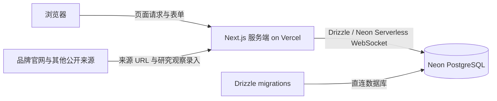

# Vercel + Neon 商品研究网站设计规格

## 状态与范围

本规格定义网站的第一阶段重设计，后续实现以此为准。它取代 [2026-10-06 Streamlit 研究工作台规格](2026-10-06-sports-brand-research-dashboard-design.md) 中关于应用技术栈、持久化方式和首批页面的决定；旧规格保留作为历史记录，其中可复用的研究口径约束继续有效。

第一阶段交付：

1. 一个部署到 Vercel 的 Next.js 网站框架。
2. 一个位于 Neon 的 PostgreSQL 数据库，作为所有结构化业务数据的唯一持久化数据源。
3. 「商品模型」页面，用于管理 SPU/SKU 模型字段。
4. 「商品数据」页面，以 SPU 为主行展示商品主体信息及最近录入的 5 个 SKU 名称，并支持 SPU/SKU 记录的新增、查看、修改和归档恢复。

第一阶段不自动导入旧 Streamlit 演示快照或本地 JSON 数据，不创建虚构商品样本。没有 Neon 数据时，网站显示清晰的数据库配置或空数据状态。

## 已确认的用户需求

- 网站使用 Vercel + Neon。
- 所有结构化商品、字段、来源及观察记录都持久化在 Neon。
- 主体采用左侧导航、右侧业务内容区。
- SPU/SKU 模型字段可新增、修改和删除。
- 商品列表以 SPU 为行，显示 SPU 主要信息和最近录入的 5 个 SKU 名称。
- 商品数据支持 SPU/SKU 新增、详情查看、修改、归档和恢复；商品记录不做物理删除。
- 自定义字段删除采用归档，保留既有值；SPU/SKU 编码和关联等系统字段不可删除。
- 商品图像在本阶段保存来源 URL，不把图像二进制文件写入数据库。
- “最近录入”按 SKU 的 `created_at` 倒序；时间相同则按稳定 ID 倒序。

## 产品目标

提供一个可持续扩展的中文商品研究后台。模型定义先于商品数据录入和展示，使不同品牌、运动和品类可通过 SPU/SKU 层级与自定义字段表达。研究数据、来源与时序观察集中保存在 Neon，后续的价格、产品组合和体育证据页面可继续读取同一数据层。

## 技术架构

### 技术栈

| 层 | 决定 |
|---|---|
| Web 应用 | Next.js App Router、React、TypeScript |
| 部署 | Vercel；本地使用 Next.js 开发服务器 |
| 数据库 | Neon PostgreSQL |
| 数据访问 | Drizzle ORM + Neon Serverless WebSocket；同一服务端连接用于查询和商品归档/恢复事务 |
| 样式 | Tailwind CSS 与项目自有可复用组件 |
| 数据库迁移 | Drizzle Kit 生成、审阅并执行版本化迁移 |
| 配置 | 服务端 `DATABASE_URL`；迁移使用直连变量 `DATABASE_URL_UNPOOLED`；`.env.local` 不入 Git |

Next.js 页面和 Route Handlers 在服务端执行数据库读写。浏览器不直接访问 Neon，不接收连接串。应用统一使用 Neon WebSocket 驱动，使普通查询和商品归档等跨多条语句的写入共享同一套数据库访问层，并默认运行在 Node.js runtime。

Neon connection string、池化连接与直连迁移方式遵循 [Neon 连接文档](https://neon.com/docs/get-started/connect-neon)；Drizzle 的 Neon HTTP/WebSocket 驱动选择遵循 [Drizzle Neon 连接文档](https://orm.drizzle.team/docs/connect-neon)。Vercel 的 Next.js 部署方式遵循 [Vercel Next.js 文档](https://vercel.com/docs/frameworks/full-stack/nextjs)。

### 数据流

Neon 存放模型定义、SPU、SKU、自定义字段值、来源登记和带时间戳的价格/可售状态观察。外部网站仍是来源事实的原始出处；Neon 保存采集到的结构化事实、来源 URL、观察时间和证据文本。本阶段不抓取或镜像整个外部网页。

Vercel Preview 环境可与 Neon 分支绑定，以隔离预览环境的数据库变更；集成方式按 [Vercel Neon 集成说明](https://vercel.com/integrations/neon) 配置。数据库及 Vercel 项目创建、连接账号、设置环境变量和部署不属于本次本地代码实现。

## SPU/SKU 业务模型

SPU 是可识别的商品主体；SKU 是其下具体销售/观察变体。平台字段并非完全统一标准，本规格采用常见商品变体实践：父商品分组标识共享，SKU 由独立编码以及颜色、尺码等变体属性区分。参考 [Google Merchant Center 商品分组字段](https://support.google.com/merchants/answer/6324507?hl=en) 和 [唯一商品标识字段](https://support.google.com/merchants/answer/160161?hl=en)。

### 系统字段

系统字段提供关系完整性、查询和列表能力，模型页面显示但不允许删除或改变字段编码与数据类型。可在不破坏兼容的前提下修改展示名称。

| 层级 | 字段 | 说明 |
|---|---|---|
| SPU | `spu_code` | 系统唯一编码 |
| SPU | `name` | 商品主体名称 |
| SPU | `brand` | Nike、Jordan、Adidas 等品牌名称 |
| SKU | `sku_code` | 系统唯一 SKU 编码 |
| SKU | `spu_id` | 必须关联到一个 SPU |
| SKU | `name` | 变体名称，供最近 SKU 列表展示 |
| 两者 | `id`, `created_at`, `updated_at` | 稳定标识和记录时间 |

### 初始可配置字段建议

SPU 初始字段：品类、运动、系列、型号/产品线、目标人群、主要用途、发售日期、简介、官方商品链接、主图来源 URL。

SKU 初始字段：颜色名称、颜色编码、尺码、尺码系统、宽度、GTIN、MPN、变体图像来源 URL、状态。

以上为字段模型初始建议；字段管理员可以按项目需求新增、编辑和归档自定义字段。价格和可售状态会随观察时间变化，不能作为静态 SKU 字段覆盖更新。

### 可配置字段定义

每个字段定义至少包含：字段 ID、SPU/SKU 层级、稳定字段编码、显示名称、数据类型、是否必填、是否唯一、选项、是否可搜索、是否默认显示在商品列表、排序位置、系统/自定义标记、归档状态、创建与更新时间。

初始字段类型：短文本、长文本、数字、布尔值、日期、URL、单选、多选。单选和多选必须带选项集合；字段编码在同一层级唯一，创建后不允许修改，以免断开历史值。

新增字段对之后的录入生效；修改展示名、选项和展示配置不会覆盖已有值。对已有数据类型的修改必须先校验所有已存值；若无法无损转换，阻止保存并说明问题。归档字段从新建/编辑表单和默认列表配置中隐藏，但历史值保留在 Neon 中，并可从商品详情查看。

## Neon 数据结构

具体列类型与约束在实施计划中细化，逻辑实体如下：

| 表 | 主要职责 |
|---|---|
| `model_fields` | SPU/SKU 字段定义、类型、规则、选项、排序和归档状态 |
| `product_code_registry` | 跨 SPU/SKU 的全局唯一编码登记，归档后仍保留 |
| `spu_products` | SPU 系统字段及记录时间 |
| `sku_products` | SKU 系统字段、父 SPU 外键、归档来源标记及记录时间 |
| `spu_field_values` | SPU 自定义字段的类型化值，外键关联 SPU 和字段定义 |
| `sku_field_values` | SKU 自定义字段的类型化值，外键关联 SKU 和字段定义 |
| `source_records` | 来源 URL、类型、市场、观察时间、证据文本、核验和公开展示状态 |
| `price_observations` | SKU 的带时间价格观察、币种、价格口径与来源外键 |
| `availability_observations` | SKU 的带时间可售/状态观察与来源外键 |

字段值使用类型化值列（文本、数字、布尔、日期、JSON 选项值），由服务端依据字段定义校验同一行只填入匹配的数据类型。每个 SPU/SKU 与字段最多有一个当前属性值。价格/可售观察则保留多条时间记录。

`sku_products.spu_id` 使用外键并建立索引。SPU 与 SKU 均有可空的 `archived_at`；SKU 另有 `archived_with_spu` 标记，用于区分由 SPU 归档操作一并归档的 SKU。系统字段和关系由数据库约束保护；商品属性由字段值表保存。

`product_code_registry.code` 对 SPU 与 SKU 共用主键；登记行以受限外键指向唯一一个 SPU 或 SKU。创建或修改编码时与商品记录在同一事务更新登记，归档时不释放编码，避免跨层级重号或恢复时冲突。

商品记录的删除动作定义为归档而非物理删除：默认列表仅查询未归档记录；归档商品保留字段值、SKU 关系、来源及价格/可售观察，可在归档视图恢复。归档 SPU 时，同一数据库事务将 SPU 及其当前启用的 SKU 设为归档，并标记这些 SKU 随 SPU 归档；恢复 SPU 时，仅恢复该操作同时归档的 SKU。此前单独归档的 SKU 仍保持归档。单独归档 SKU 不影响父 SPU。并发冲突、外键约束或唯一性约束失败时，整个操作回滚并显示可理解错误。

## 页面与交互

### 全局框架

- 桌面：左侧固定主导航，右侧页面内容区域；移动端导航折叠为抽屉。
- 左侧导航只启用两个页面：商品模型、商品数据。后续分析菜单留待后续计划，不显示空的假功能。
- 内容区使用统一页面标题、说明、数据来源/连接状态和主要操作入口。
- 视觉方向是轻量研究管理后台：浅色工作区、清晰层级、可读表格和明确表单状态；不复制 Nike 品牌标志或营销页视觉。
- 正式环境功能启用前必须有访问控制。第一阶段仅本地运行或受保护的私有预览；未配置认证的公开访问不得开放模型字段写操作。

### 商品模型

- 页内以 SPU 字段、SKU 字段两个分组/标签呈现。
- 字段表列出显示名称、编码、层级、类型、必填、选项、列表/搜索状态、系统/自定义及操作。
- 新增和编辑使用表单；字段名称、编码、类型、选项、必填和列表显示状态均校验。
- 系统字段不可归档；自定义字段归档前要求确认，归档不物理删除字段定义或数据值。
- 同层级字段编码重复、选项类型缺失选项、非法类型转换均阻止保存并显示具体原因。

### 商品数据

- SPU 为列表主记录，每行一个 SPU，不把 SKU 展开成多行。
- 默认列包含 SPU 编码、商品名、品牌、品类、运动、系列/型号、SKU 数量、最近更新时间、最近 SKU 名称。
- 最近 SKU 名称最多显示 5 个，按 SKU `created_at DESC, id DESC` 取得；SKU 少于 5 个时展示现存数量，无 SKU 时显示明确空值。
- 可展开一行查看 SKU 明细和字段值；默认列表可显示配置为 `show_in_list` 的自定义 SPU 字段。
- 支持按 SPU 名称/编码搜索、按品牌/运动/品类筛选、分页；默认 SPU 顺序为 `updated_at DESC, id DESC`。
- 商品列表只显示 Neon 查询结果，空表显示“Neon 当前没有商品记录”，不以本地样例填充。
- 列表默认只显示未归档 SPU，可切换到归档记录视图并恢复记录；搜索、筛选和分页在数据库查询层执行。
- 每个 SPU 提供“查看/编辑/归档”操作；详情显示全部 SPU 字段、SKU 明细与其自定义字段，并提供新增 SKU 入口。
- 新建 SPU 表单包含系统必填字段和全部启用的 SPU 模型字段；新建 SKU 必须从某个 SPU 详情中发起，并包含全部启用的 SKU 模型字段。
- SPU/SKU 编辑表单使用当前启用模型字段；更新系统字段及自定义字段值时验证必填、数据类型、选项和唯一约束，成功后更新 `updated_at`。
- SKU 可单独查看、编辑、归档和恢复；归档 SKU 会从默认 SKU 摘要和计数中排除，但保留历史关系及观察记录。
- 归档操作须二次确认并说明受影响记录数。恢复 SPU 时同时恢复其此前因该 SPU 归档而归档的 SKU；单独归档的 SKU 继续保持归档。
- SPU/SKU 编码由 `product_code_registry` 跨层级保持全局唯一，即使记录已归档也不可被其他记录重用；恢复时登记仍有效，不释放编码。
- 商品详情和编辑/归档操作均校验记录存在及归档状态；SKU 编辑不允许更改所属 SPU。

## 数据安全与错误状态

- Neon 凭据仅存在服务端环境变量；不得使用 `NEXT_PUBLIC_` 前缀暴露连接串。
- 输入由服务端按字段定义校验；查询使用参数化 ORM 查询。
- 字段归档、类型调整和 SPU/SKU 关联遵守数据库外键与唯一约束；失败时返回可理解错误。
- 缺失 `DATABASE_URL` 时显示开发配置说明，禁止切换到本地 JSON、内存数据或虚构演示记录。
- 数据库连接失败时显示非敏感错误信息，不回显连接串、SQL 凭据或内部栈信息。
- 列表请求限制单页数量，按索引字段搜索和排序；SKU 摘要在数据库查询层取最近五条，避免为每行加载全部 SKU。
- 生产或公开 Preview 发布前必须完成认证/访问控制和环境变量审查。

## 第一阶段验收标准

1. 项目使用 Next.js App Router，可在本地启动并可构建为 Vercel 部署项目。
2. 应用只通过服务端连接 Neon；没有数据库连接时显示配置状态，不显示本地模拟业务数据。
3. 页面有左侧导航和右侧主体，两个菜单可切换且移动端可用。
4. 商品模型页可读取 Neon 字段定义，新增、编辑和归档自定义 SPU/SKU 字段；系统字段不能删除。
5. 字段必填、类型、唯一编码、选项和类型修改均通过服务端校验。
6. 商品数据页按 SPU 一行展示，包含 SPU 主要信息、SKU 数量及按录入时间排序的最多 5 个 SKU 名称。
7. 商品数据页可创建、查看、修改 SPU/SKU；启用字段、必填、数据类型、选项和唯一编码均通过服务端校验。
8. 归档/恢复 SPU 和 SKU 不物理删除记录；SPU 与启用 SKU 的级联归档、按标记恢复、单独归档 SKU 保持归档及观察历史保留均正确。
9. SKU 外键保证其关联的 SPU 存在；价格与可售观察可保留来源及时间。
10. 没有商品、没有 SKU、字段归档和数据库连接失败等状态均可理解且无虚构数据。
11. 关键字段管理、CRUD、归档恢复、查询排序、列表边界和错误状态有自动化验证；实际页面进行桌面与窄屏人工检查。

## 不属于第一阶段

- 真实商品采集、爬虫、CSV 批量导入和旧 Streamlit 本地快照迁移。
- 用户账户、团队协作及认证提供方选择；但公开或生产环境启用写入前必须补齐访问控制。
- 价格图表、目录分析、NBA/足球关系分析、论文导出及申请作品集页面。
- 产品图片二进制存储、图像识别和文件存储服务。

## 设计复核清单

- 明确历史 Streamlit 规格由本规格替代，避免两套互相矛盾的当前架构。
- 价格和可售状态以时间观察保存，不能静态覆盖 SKU 字段。
- 删除自定义字段只归档并保留值；编码和系统关系保持稳定。
- 最近五个 SKU 查询按 `created_at DESC, id DESC`，不会返回任意五条。
- 无数据库或空表时不读本地演示集，满足 Neon 为唯一结构化数据源的要求。
- 商品记录使用归档而非物理删除；SPU 与其 SKU 的归档/恢复规则保留可审计观察历史。
